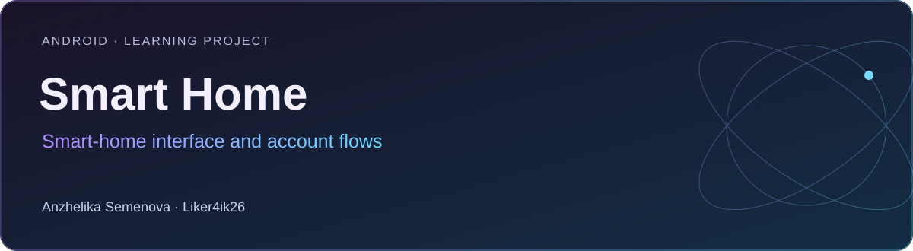

# Smart Home

**Android · Learning project** · Kotlin · Jetpack Compose · Material 3 · Hilt · Supabase · Ktor · Compose Destinations

Учебное Android-приложение с интерфейсами умного дома: комнаты, устройства, параметры оборудования и пользовательский аккаунт.

[Портфолио автора](https://portfolio.semenova-anzhelika.online/) · [Профиль GitHub](https://github.com/Liker4ik26) · [Исходники](https://github.com/Liker4ik26/smart_home/tree/master)

## Что в проекте

- Экраны комнат и добавления устройств.
- Интерфейсы освещения, температуры, кондиционера и вытяжки.
- Регистрация, вход, PIN-код и профиль.
- Слой аутентификации с Supabase и внедрение зависимостей через Hilt.

## Технологии

| Направление | Реализация |
| :--- | :--- |
| Стек | Kotlin · Jetpack Compose · Material 3 · Hilt · Supabase · Ktor · Compose Destinations |
| Формат | Android · Learning project |
| Окружение | Android Studio; JDK 17; compileSdk 34; minSdk 24 |

## Где смотреть код

- app/src/main/java/com/example/smartHome/screen/ — экраны
- app/src/main/java/com/example/smartHome/supabase/ — доступ к данным
- app/src/main/java/com/example/smartHome/presentation/ — корневая навигация

## Как запустить

Требования: Android Studio; JDK 17; compileSdk 34; minSdk 24.

```bash
git clone --branch master https://github.com/Liker4ik26/smart_home.git
cd smart_home
```

Откройте корень репозитория в Android Studio, выполните Gradle Sync и выберите Android-эмулятор или устройство. Для сборки из терминала:

```bash
bash gradlew :app:assembleDebug
```

Для сетевых сценариев потребуется собственная конфигурация Supabase. Интерфейсы управления устройствами сами по себе не подтверждают подключение к физическому оборудованию.

## English overview

**Smart Home — Smart-home interface and account flows.**

Android · Learning project. Stack: Kotlin · Jetpack Compose · Material 3 · Hilt · Supabase · Ktor · Compose Destinations. [Explore my professional portfolio](https://portfolio.semenova-anzhelika.online/).

---

**Автор — Анжелика Семёнова · [Liker4ik26](https://github.com/Liker4ik26)**

[Сайт](https://portfolio.semenova-anzhelika.online/) · [Telegram](https://t.me/Liker4ik50) · [Почта](mailto:pr110oat18@gmail.com)
